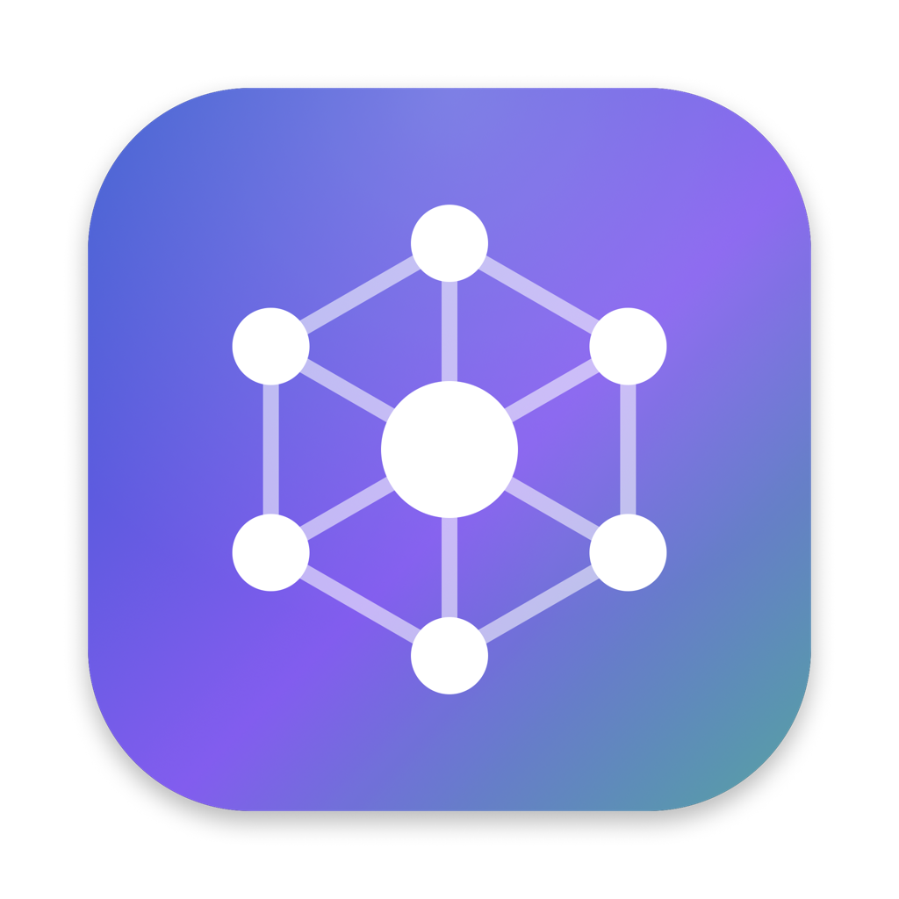
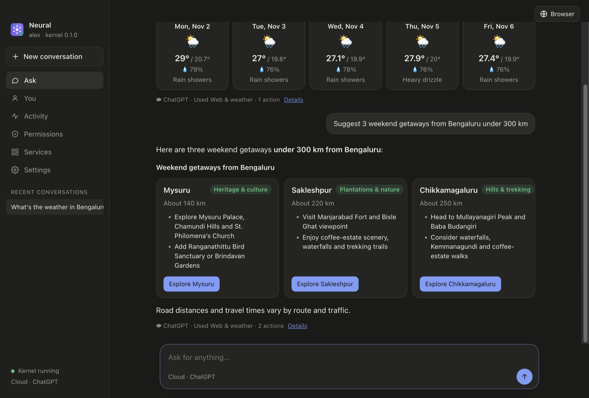
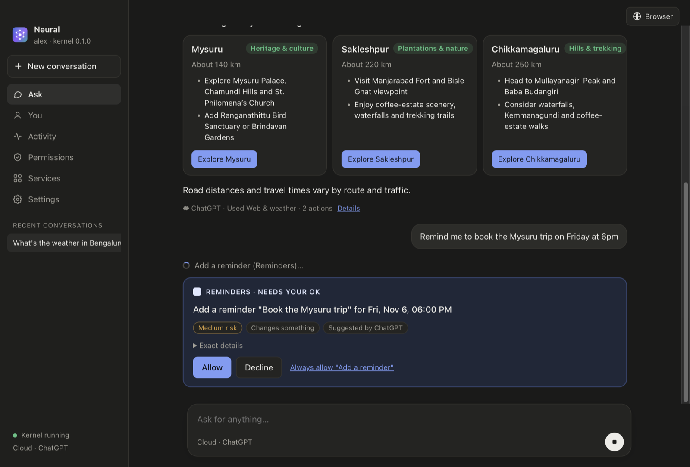
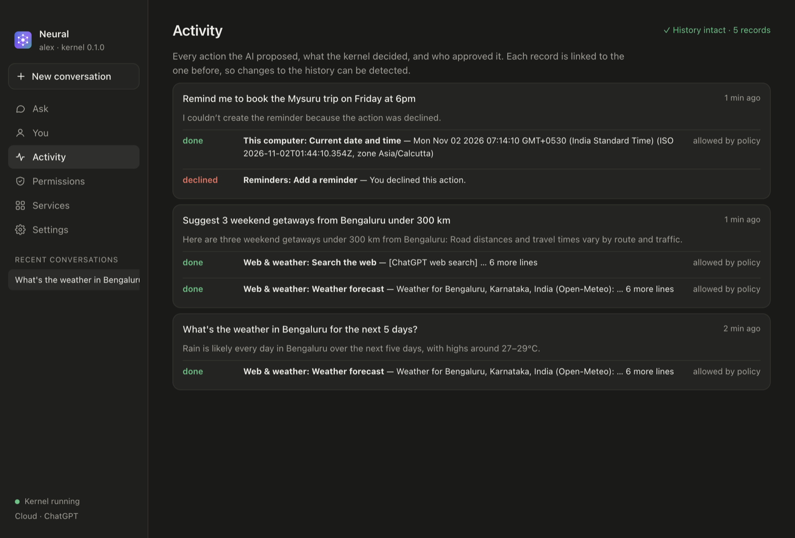

<p align="center"></p>

<h1 align="center">Neural</h1>

<p align="center"><b>Say what you want done. Neural does it, and asks before anything important.</b><br />
An open-source AI desktop app built on <b>Unified AI Base</b>: any AI model, your apps and services, and a trusted kernel that stays in charge.</p>

<p align="center"><i>AI proposes. The kernel authorises.</i></p>

---

> **Public alpha.** Mac only for now (Apple silicon). Expect rough edges, and please [open an issue](../../issues) when you hit one.

## What it does

Ask in your own words. Neural works out the steps and uses the services you've connected:

- *"What's on my calendar tomorrow?"* · *"Remind me to call the bank at 10"*
- *"Find the Q3 report in Documents and email it to Sam"*
- *"Any important emails today?"* (Gmail or Apple Mail)
- *"Find good biryani places near me on Zomato"*
- *"What's the weather this weekend?"* · *"Summarise this page"* (built-in browser)

Answers come back as readable documents: tables, option cards, forecasts, timelines and follow-up buttons, not a wall of chat.

<p align="center"></p>

| Anything important waits for you | Every action is on record |
|---|---|
|  |  |

## Why it's different

| | Typical AI assistant | Neural |
|---|---|---|
| Who decides what runs | The model | A **trusted kernel**, separate from every model |
| Consequential actions | Often just run | Sending, changing, ordering and deleting **wait for your OK** |
| Model | Fixed | **Your choice**: Apple's on-device model, your ChatGPT plan, Gemini, Claude or a local model |
| Your keys and sign-ins | Often handed to the model or app | Kept in the macOS Keychain by the kernel; **the AI never sees them** |
| What the AI knows about you | Hidden | A **You** screen shows exactly what's sent, and cloud models get less |
| History | Hard to check | Every action in a **tamper-evident activity log** |
| Integrations | Built into one product | Any **MCP** service, local or online |

## Get it

1. Download **Neural-x.y.z-arm64.dmg** from [Releases](../../releases).
2. Open it and drag **Neural** to Applications.
3. The alpha isn't signed with an Apple Developer ID yet, so the first time, **right-click Neural → Open → Open**. (Or: System Settings → Privacy & Security → *Open Anyway*.)
4. A short welcome lets you pick the AI, tell it your name and city (optional), and share some folders.
5. **Updates:** this alpha can't update itself (it isn't signed), so Neural shows a notice in the sidebar when a new version is out. Download it and drag it into Applications again. You can turn the check off in Settings.

### Choosing the AI

| Option | Cost | Notes |
|---|---|---|
| **Built-in** | Free | Apple Intelligence on this Mac; private and offline. Best for everyday tasks. |
| **ChatGPT** | Your Plus/Pro plan | Sign in with ChatGPT; no API key. The kernel holds the sign-in. |
| **Gemini** | Free tier | Paste a free key from aistudio.google.com. |
| **Claude, OpenAI-compatible** | API billing | Paste a key; it never leaves the kernel. |
| **Local server** | Free | Ollama, LM Studio or llama.cpp on your machine. |

### Connecting services

Built in: Files (only folders you share), Apple Mail, Contacts, Calendar, Reminders, web search and weather, a built-in browser, and this Mac (notifications, opening files).

- **Gmail**: one-time setup, see [docs/gmail-setup.md](docs/gmail-setup.md).
- **Any MCP service**: Services → *Add a service*, then paste its address. Services that need an account show a **Sign in** button (standard MCP sign-in). For example Zomato's is `https://mcp-server.zomato.com/mcp` (Zomato currently allows personal and testing use).

## How it works

```
 You ── Neural app ── Model gateway ── any model (on-device or cloud)
                           │  proposals only
                           ▼
                  ┌──────────────────┐
                  │  Trusted kernel  │  permissions · approvals · vault · context
                  │  (own process)   │  verification · tamper-evident audit
                  └────────┬─────────┘
                           ▼
          Built-in services · MCP services · your Mac's apps
```

Every request follows the same lifecycle: **understand → discover → propose → validate → confirm → execute → verify**. The model can only *propose* actions; the kernel checks them against your permissions, asks you when needed, runs them, checks the result and records it. More in [docs/how-it-works.md](docs/how-it-works.md).

## Your data

Everything stays on your Mac, in `~/.uab`: settings, permissions, your profile and memories, conversations and the activity log. Keys and sign-ins live in the macOS Keychain. There's no telemetry. Cloud models receive only what each request needs, and the **You** screen shows you exactly what that is.

## Build from source

Requirements: macOS on Apple silicon, Node 22+, Xcode command line tools (for the on-device model helper).

```bash
npm install
npm start            # build and open the app
npm test             # end-to-end tests (real kernel process, scripted models)
npm run package      # build release/dist/Neural-<version>-arm64.dmg
```

```
packages/
  protocol/   The shared contract: capabilities, proposals, decisions, audit records, kernel RPC
  kernel/     The trusted kernel: policy, approvals, vault, context and memory, MCP host, audit
  gateway/    The intelligence layer: model providers turn requests into proposals
  cli/        A command-line host: uab "…"
apps/
  desktop/    Neural, the Electron app
tests/        End-to-end tests
```

## Roadmap

- [x] Trusted kernel: policy, approvals, no repeated actions, verification, tamper-evident audit, vault
- [x] Any model: Apple on-device, ChatGPT plan, Gemini, Claude, local servers
- [x] MCP host: local and online services with sign-in
- [x] Context and memory you control, with on-device relevance picking for cloud models
- [x] Desktop app with document-style answers and visual blocks
- [ ] Provider SDK and conformance tests, so anyone can build a connector
- [ ] The kernel as an MCP server, so other AI apps can act through it
- [ ] Voice input
- [ ] Linux and Windows
- [ ] Android and cross-device continuity (Generation 2)

## License

[Apache-2.0](LICENSE). The bundled embedding model ([all-MiniLM-L6-v2](https://huggingface.co/Xenova/all-MiniLM-L6-v2)) is also Apache-2.0.
